<div align="center">
  
  <h1>Surge Relay</h1>
  <p>在 Mac 上管理 Surge 模块和机场订阅。</p>
  <p>
    <a href="https://github.com/EEliberto/SurgeRelay-macOS/releases/latest"><strong>下载 Surge Relay</strong></a>
    &nbsp;·&nbsp;
    <a href="CHANGELOG.md">更新日志</a>
    &nbsp;·&nbsp;
    <a href="docs/Automation.md">自动化访问</a>
  </p>
  <p><sub>需要 macOS 26 或更高版本，以及搭载 Apple 芯片的 Mac。</sub></p>
</div>

<p align="center">
  <a href="docs/images/module-overview.png">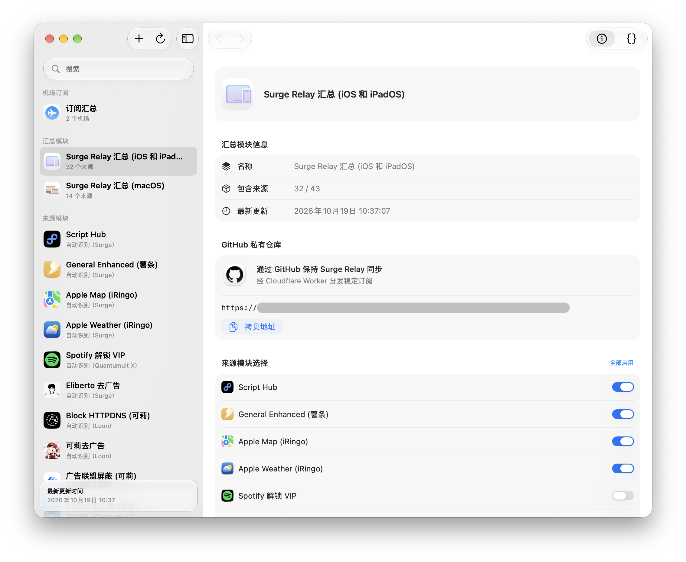</a>
</p>

## 开始使用

1. 下载并打开 [Surge Relay 磁盘映像](https://github.com/EEliberto/SurgeRelay-macOS/releases/latest)，将 App 拖到“应用程序”文件夹。
2. 打开 App，完成初始设置。选择用于保存生成模块的 Surge 目录，或配置 GitHub 与 Cloudflare 发布。
3. 点按工具栏中的“+”，添加模块来源。
4. 在对应平台的汇总模块中，选择需要启用的来源，然后刷新。
5. 在 Surge 中添加生成的本地模块，或订阅发布后的模块 URL。

使用 GitHub 与 Cloudflare 时，请参阅[配置指南](docs/GitHub-Cloudflare-Guide.md)。

## 管理模块

Surge Relay 可读取 Surge 模块，并通过内置的 [Script Hub](https://github.com/Script-Hub-Org) 引擎转换 Loon 插件和 Quantumult X 重写。转换在 Mac 上完成。

选择一个来源模块后，可以查看来源地址、刷新状态及可用参数。点按“编辑”可更改名称、来源格式、刷新间隔和转换选项。刷新间隔选择“自动”时，使用通用设置中的间隔。

<p align="center">
  <a href="docs/images/module-editor.png">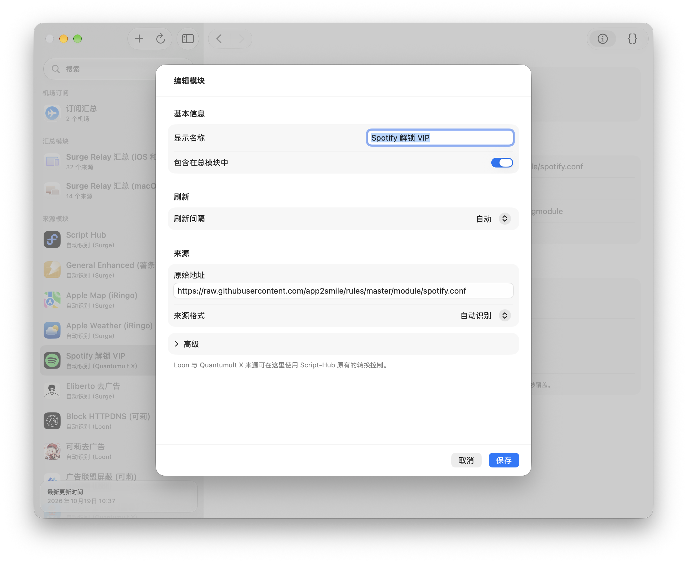</a>
</p>

<p align="center">
  <a href="docs/images/module-arguments.png">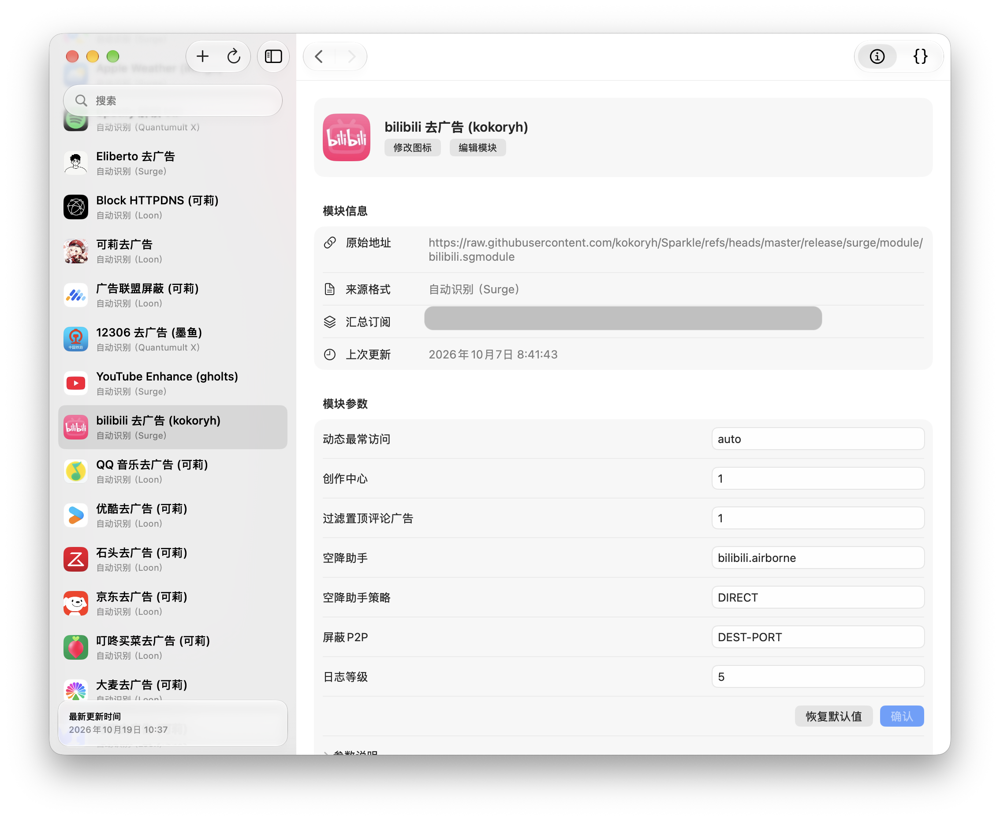</a>
</p>

在“预览”中可以搜索和编辑生成的内容。写入的自定义修改会在后续处理中保留；如果上游变更与修改冲突，请检查提示和当前内容。

<p align="center">
  <a href="docs/images/module-preview.png">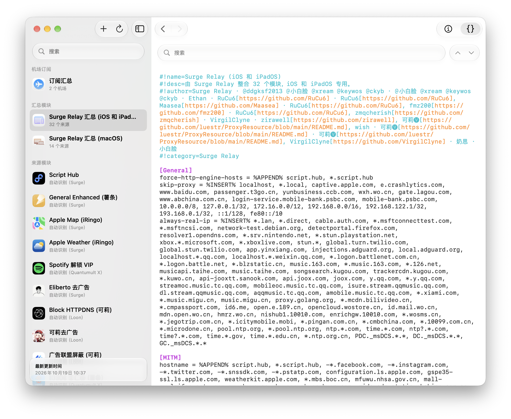</a>
</p>

## 管理机场订阅

选择侧栏中的“订阅汇总”，添加机场名称和订阅链接。添加 Surge 配置后，开启需要写入的配置，并点按“写入配置”。

每个机场的节点保存在目标配置旁的独立 `.proxies` 文件中，主配置通过 `policy-path` 引用。订阅地址、重定向地址和节点服务器对应的直连规则会一并维护。

在“编辑机场”中，可以按关键词或正则表达式筛选节点、调整排序、设置名称模板，以及修改 UDP Relay、TCP Fast Open 等代理属性。代理属性选择“自动”时保留订阅原值。

<p align="center">
  <a href="docs/images/airport-overview.png">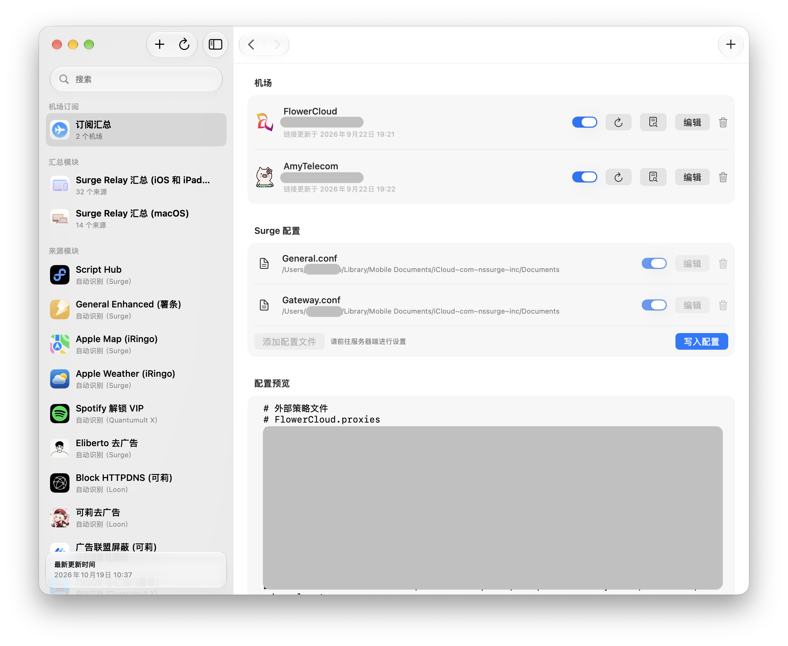</a>
</p>

<p align="center">
  <a href="docs/images/airport-options.png">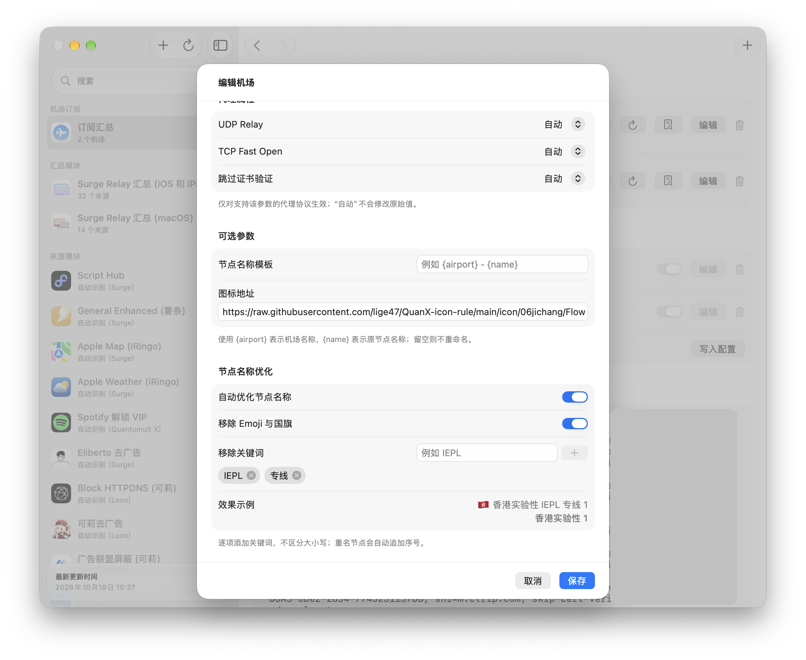</a>
</p>

## 选择同步方式

在“设置”>“同步”中选择以下一种方式：

- **iCloud 云盘**：将生成的模块保存到 Surge 文件夹，通过 iCloud 同步。请确保其他设备已启用 iCloud 云盘，并等待文件下载完成。
- **GitHub 私有仓库**：将模块和生成的脚本发布到私有仓库，通过 Cloudflare Worker 提供订阅地址。完成配置后，在 Surge 中添加对应的固定 URL。

<p align="center">
  <a href="docs/images/sync-icloud.png">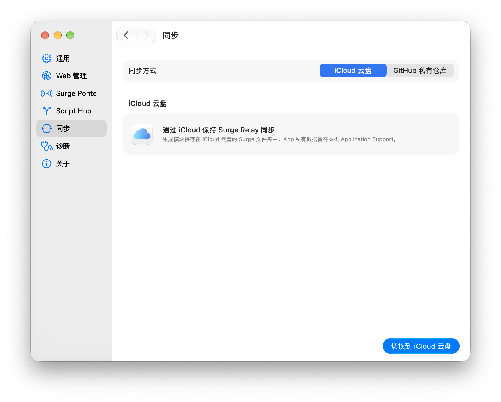</a>
</p>

<p align="center">
  <a href="docs/images/sync-github.png">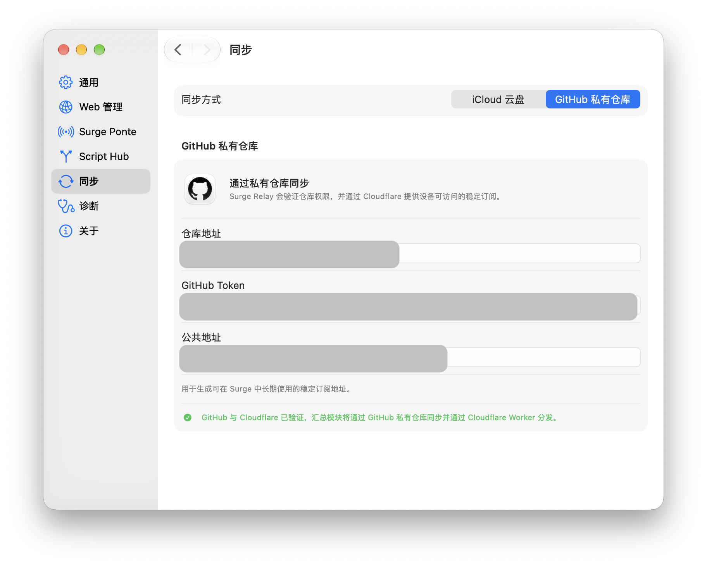</a>
</p>

发布后的文件可继续被设备读取。Mac 离线期间不会获取或转换新的上游内容；重新上线后，可手动刷新或等待下一次自动刷新。

## 在 Surge 中使用汇总模块

Surge Relay 分别生成适用于 iOS 和 iPadOS、macOS、tvOS、visionOS 的汇总模块。不同平台可以启用不同的来源。请在设备上安装对应平台的模块，并在 Surge 中启用。

<p align="center">
  <a href="docs/images/surge-macos.png">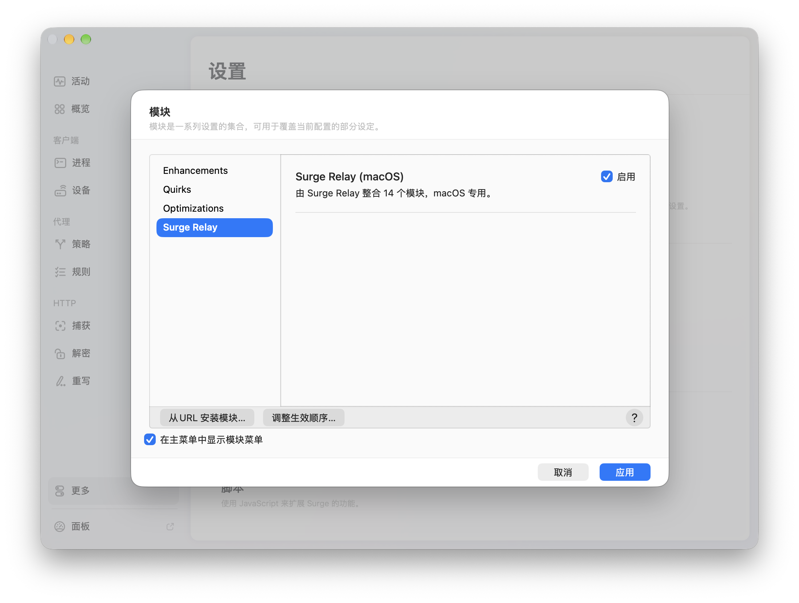</a>
  <a href="docs/images/surge-iphone.png">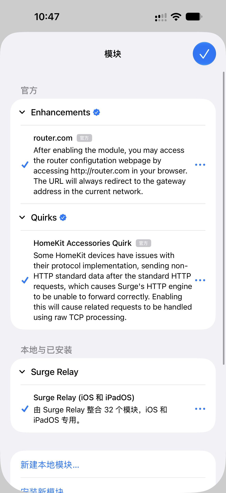</a>
</p>

## 服务器与客户端模式

在“设置”>“Surge Ponte”中选择这台 Mac 的用途：

- **服务器模式**：在这台 Mac 上保存来源配置、获取订阅、执行转换和发布。服务器需要保持运行，可以关闭主窗口并通过菜单栏使用。
- **客户端模式**：连接另一台运行 Surge Relay 的 Mac，查看和管理服务器上的模块与机场订阅。输入服务器的 Surge Ponte 地址后，点按“测试连接”。

使用客户端前，请在服务器上开启 Web 管理，并确保客户端可以通过 Surge Ponte 访问该地址。客户端不再开启另一套 Web 服务。

<p align="center">
  <a href="docs/images/ponte-client.png">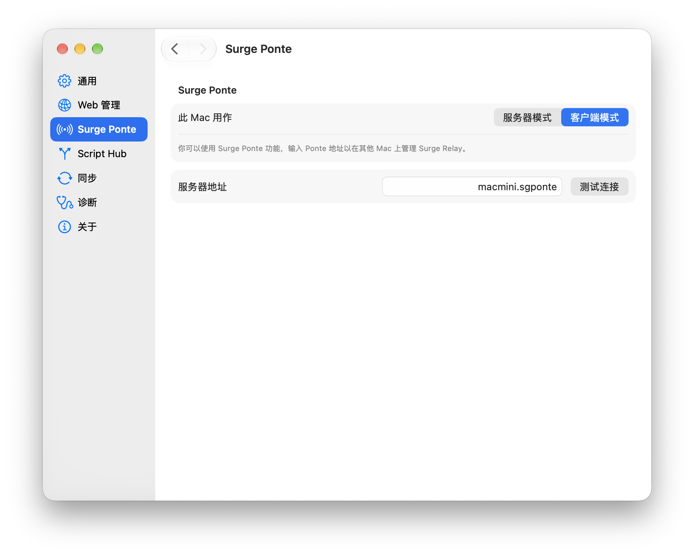</a>
</p>

## 使用 Web 管理

在服务器的“设置”>“Web 管理”中开启服务，然后在浏览器中打开显示的地址。同一网络中的设备可使用 Bonjour 地址；通过 Surge Ponte 连接时，使用服务器的 Ponte 地址及 Web 管理端口。

Web 界面支持模块与机场编辑、正文预览、刷新和设置管理，适用于 Mac、iPad 和 iPhone 的浏览器。

<p align="center">
  <a href="docs/images/web-ipad.png">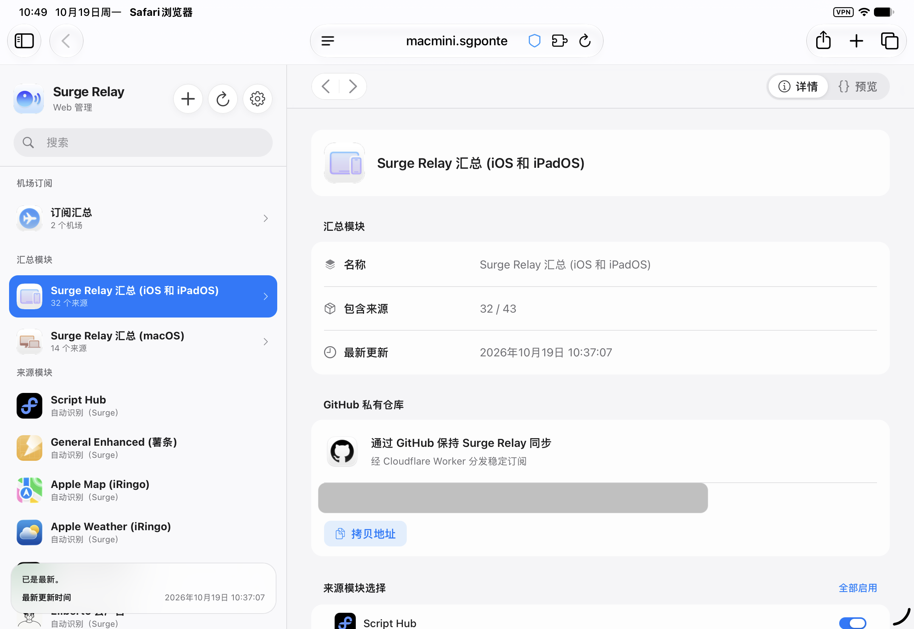</a>
  <a href="docs/images/web-iphone.png">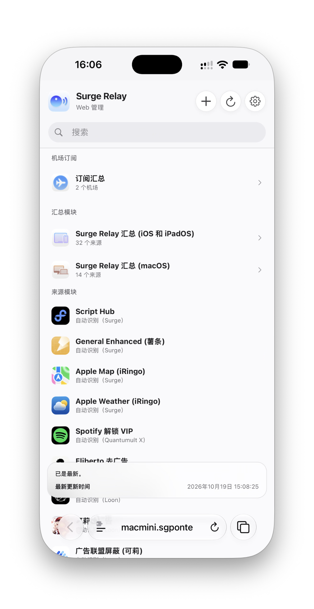</a>
</p>

## 使用外部 Agent 或自动化工具

在服务器的“设置”>“Web 管理”中开启“允许本机 Agent 访问”，拷贝访问令牌，并选择允许的操作。外部工具可通过 REST API 或 MCP 查询状态、搜索配置、预览修改，以及执行刷新和发布。

默认只允许读取。修改会先生成预览，应用前检查内容是否已经变化。具体配置和调用示例见[自动化访问](docs/Automation.md)。

## 如果 Mac 无法打开 Surge Relay

如果系统提示 App 已损坏或无法验证开发者，请先确认安装包来自本仓库的 Releases 页面。确认后，可打开“终端”App，输入以下命令并按下 Return 键：

```bash
sudo xattr -rd com.apple.quarantine "/Applications/Surge Relay.app"
```

输入 Mac 登录密码后，再次打开 Surge Relay。输入密码时，“终端”不会显示字符。

## 从源码构建

使用 Xcode 打开 `Surge Relay.xcodeproj`，选择 `Surge Relay` scheme 后运行。项目使用 Swift 6 和 SwiftUI；首次构建需要下载 Sparkle 依赖。

修改 `project.yml` 后，使用 XcodeGen 重新生成工程：

```sh
xcodegen generate
```

<details>
  <summary>模块来源与使用声明</summary>
  <br>
  Surge Relay 仅提供模块管理、转换、编辑和发布功能。README 中出现的模块、作者和来源仅用于展示产品能力，不代表推荐、背书或安全保证。模块的版权、署名、许可协议和使用限制均归原作者或原项目所有。使用、转换、编辑、分发或订阅模块前，请确认相应来源、许可、用途和风险。
  <br><br>
  示例可能包含 Surge Relay、@小白脸、@xream、@keywos、@ckyb、Ethan、<a href="https://github.com/RuCu6">RuCu6</a>、<a href="https://github.com/Maasea">Maasea</a>、<a href="https://github.com/fmz200">fmz200</a>、<a href="https://github.com/kelv1n1n">kelv1n1n</a>、<a href="https://github.com/luestr/ProxyResource/blob/main/README.md">可莉</a>、<a href="https://github.com/zmqcherish">zmqcherish</a>、<a href="https://github.com/VirgilClyne">VirgilClyne</a>、<a href="https://github.com/zirawell">zirawell</a>、wish 和奶思等来源。
</details>

<br>

<div align="center">
  <p><a href="https://github.com/EEliberto/SurgeRelay-macOS/issues">报告问题</a>&nbsp;&nbsp;·&nbsp;&nbsp;<a href="LICENSE">Apache License 2.0</a>&nbsp;&nbsp;·&nbsp;&nbsp;<a href="THIRD_PARTY_NOTICES.md">第三方软件声明</a></p>
  <sub>Surge Relay 与 Surge、Apple、GitHub、Cloudflare 及文中提及的模块项目无隶属关系。相关名称和商标归各自所有者所有。</sub>
</div>
